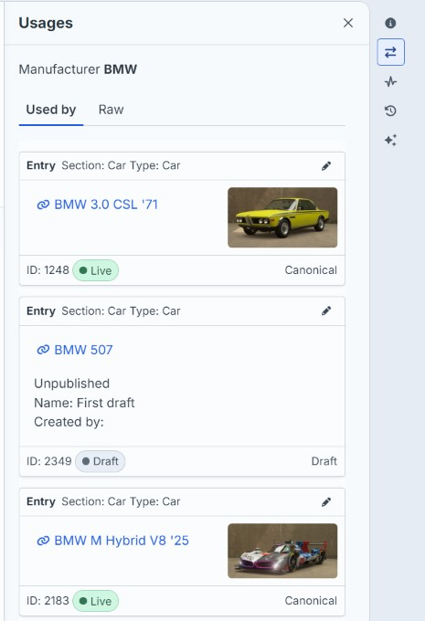
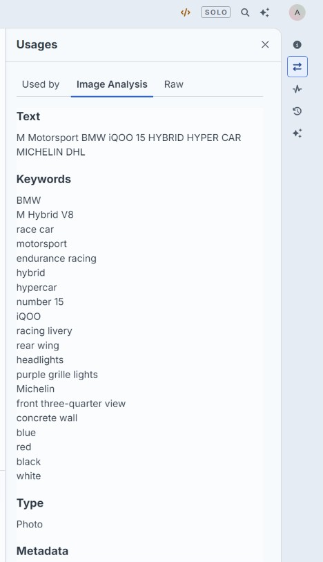

# Craft 6 Usages

This plugin is a Craft 6 helper plugin that shows usages of elements inside the Craft Control Panel.

In practice, it helps editors/developers quickly see where a given element is being used, so it’s easier to assess impact before editing or deleting content.

Also displays image analysis data for assets.

Warning: This plugin is highly experimental and is not yet ready for production use.

It may miss some usages with drafts, revisions, nested elements, and other edge cases. It is also not yet optimized for performance.

## Screenshots

